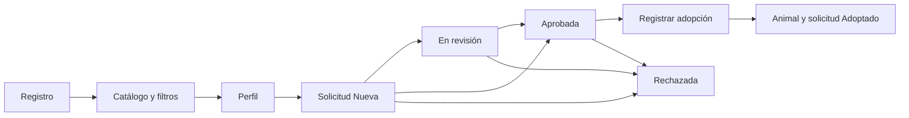

> Actualización multirrefugio: consultar [diseño y actualización vigentes](10-multirrefugio.md). Las referencias a un refugio único y al estado previo de los PR pertenecen a la etapa inicial.

# Casos de uso

Actores: visitante, adoptante, administrador y veterinario.

## CU01 — Gestionar una adopción

Precondición: existe un animal disponible. El visitante se registra, consulta el catálogo, abre el perfil y completa su solicitud. Laravel toma su identidad de la sesión. El adoptante consulta su seguimiento. Un administrador revisa el formulario y registra su decisión con un motivo visible para el adoptante.

Una aprobación coloca al animal en proceso de adopción y permite **registrar la adopción** mediante otra operación. Esta crea el registro definitivo, actualiza solicitud y animal a Adoptado y cierra otras solicitudes activas con motivo explícito e historial. La operación completa es transaccional.

Flujos alternativos: formulario inválido devuelve errores; solicitud activa duplicada se rechaza; animal no disponible impide solicitar; rechazo cierra el recorrido; rechazo de una aprobación libera la reserva. Una solicitud rechazada o adoptada es terminal. Una solicitud nueva no puede saltar directamente a Adoptado.

## Otros casos

- CU02: administrador registra o edita un animal y administra sus fotos. Si tiene solicitudes activas no puede archivarlo ni ponerlo temporalmente no disponible. El archivo es lógico y conserva relaciones.
- CU03: veterinario consulta antecedentes, registra una atención y programa controles. Solo el autor puede corregir su registro; no existe borrado clínico.
- CU04: personal autorizado consulta controles pendientes y dosis próximas. Se distingue control vencido de próximo. Al realizarlo, el veterinario actualiza su estado desde la historia clínica.
- CU05: administrador consulta indicadores y actividad reciente. Los gráficos muestran datos reales y no generan valores simulados.
