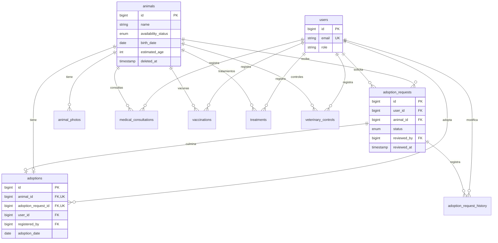
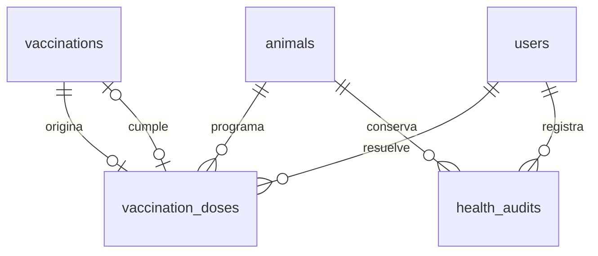

> Actualización multirrefugio: consultar [diseño y actualización vigentes](10-multirrefugio.md). Las referencias a un refugio único y al estado previo de los PR pertenecen a la etapa inicial.

# Base de datos

Conexión real `mysql`, base `refugio_animales`, codificación utf8mb4. XAMPP puede incluir MariaDB; se verificó el esquema en MariaDB 10.4.32. CI configura MySQL 8.4. Testing usa una base separada o SQLite en memoria por defecto; SQLite nunca reemplaza la base de la aplicación.

Las tres migraciones de infraestructura crean usuarios/sesiones, caché y jobs. `2026_10_14_000001_create_shelter_tables` amplía usuarios y crea animales, fotos, solicitudes, adopciones, historial y cuatro entidades clínicas.

`estimated_age` representa meses. La fecha de nacimiento tiene prioridad en el filtro por edad. Los estados de solicitudes son exactamente Nueva, En revisión, Aprobada, Rechazada y Adoptado. La disponibilidad del animal se administra de forma independiente hasta aprobar una solicitud.

Integridad: claves foráneas restrictivas, email único, animal y solicitud únicos en adopciones, índices por disponibilidad, especie, estado y vencimientos. `animals.deleted_at` conserva registros archivados. No se borran físicamente adopciones ni antecedentes. Los roles no son asignables en masa en User. No se ofrecen cancelaciones de adopciones ni readopciones en esta versión: la unicidad por animal es permanente.

Las reglas de duplicados activos y aprobación única se serializan bloqueando siempre primero la fila del animal dentro de una transacción. La restricción única de adopciones constituye una segunda defensa. Todo ingreso de solicitudes debe pasar por AdoptionService, incluyendo futuros módulos.

El historial incluye actor, estado anterior/nuevo, observaciones y timestamps. Al finalizar una adopción, otras solicitudes pendientes pasan a Rechazada con un motivo explícito visible en su seguimiento; no se rechazan al aprobar, para permitir reanudar la evaluación si la aprobación no se concreta.

## Programación de dosis y auditoría sanitaria

La migración aditiva `2026_10_15_000003_add_health_agenda_and_audits` conserva todas las tablas y campos anteriores. `vaccination_doses` tiene animal_id, source_vaccination_id único, application_vaccination_id nullable único, scheduled_date, status (Pendiente/Aplicada/Cancelada), legacy_unverified, cancellation_reason, resolved_by y resolved_at. Las claves foráneas son restrictivas; una resolución no borra la vacunación de origen. Se copian próximas fechas previas como pendientes sin cumplimiento verificado, sin aplicaciones ni autorías inventadas.

`health_audits` guarda animal_id, record_type, record_id, actor_id, action, before_values/after_values JSON y created_at. No se modifica desde la interfaz. El servicio escribe auditoría y cambio en la misma transacción; migrar no reconstruye auditorías previas. Los cuatro registros conservan recorded_by y actualizan updated_by desde la sesión; practitioner_name identifica al profesional que atendió, no a un rol del sistema.

Solo GET de historia permite archivados, siempre dentro del refugio activo y con rol admin. Las escrituras vuelven a verificar archivo/permisos bajo bloqueo. Ver [criterios y compatibilidad](13-salud-agenda-entrega.md).
