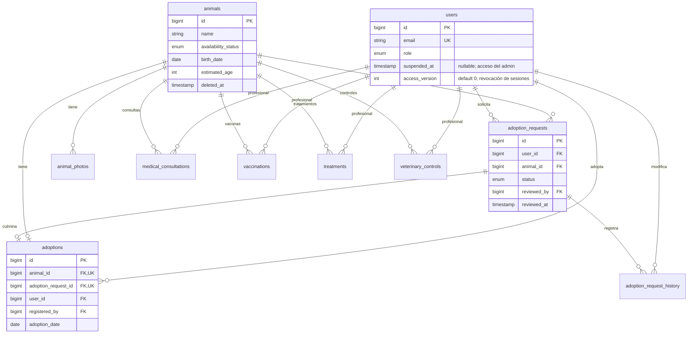

> Actualización multirrefugio: consultar [diseño y actualización vigentes](10-multirrefugio.md). Las referencias a un refugio único y al estado previo de los PR pertenecen a la etapa inicial.

# Base de datos

Conexión real `mysql`, base `refugio_animales`, codificación utf8mb4. XAMPP puede incluir MariaDB; se verificó el esquema en MariaDB 10.4.32. CI configura MySQL 8.4. Testing usa una base separada o SQLite en memoria por defecto; SQLite nunca reemplaza la base de la aplicación.

Las tres migraciones de infraestructura crean usuarios/sesiones, caché y jobs. `2026_10_14_000001_create_shelter_tables` amplía usuarios y crea animales, fotos, solicitudes, adopciones, historial y cuatro entidades clínicas.

`estimated_age` representa meses. La fecha de nacimiento tiene prioridad en el filtro por edad. Los estados de solicitudes son exactamente Nueva, En revisión, Aprobada, Rechazada y Adoptado. La disponibilidad del animal se administra de forma independiente hasta aprobar una solicitud.

Integridad: claves foráneas restrictivas, email único, animal y solicitud únicos en adopciones, índices por disponibilidad, especie, estado y vencimientos. `animals.deleted_at` conserva registros archivados. No se borran físicamente adopciones ni antecedentes. Los roles no son asignables en masa en User. No se ofrecen cancelaciones de adopciones ni readopciones en esta versión: la unicidad por animal es permanente.

Las reglas de duplicados activos y aprobación única se serializan bloqueando siempre primero la fila del animal dentro de una transacción. La restricción única de adopciones constituye una segunda defensa. Todo ingreso de solicitudes debe pasar por AdoptionService, incluyendo futuros módulos.

El historial incluye actor, estado anterior/nuevo, observaciones y timestamps. Al finalizar una adopción, otras solicitudes pendientes pasan a Rechazada con un motivo explícito visible en su seguimiento; no se rechazan al aprobar, para permitir reanudar la evaluación si la aprobación no se concreta.

La migración nueva `2026_10_15_000002_add_staff_access_controls` agrega `users.suspended_at` (nullable) y `access_version` (entero sin signo, 0 inicialmente). No cambia credenciales, roles, refugios ni relaciones anteriores. Solo el superadministrador modifica estos campos para cuentas `admin` de la institución indicada; no hay traslado de cuentas. Suspender, reactivar o cambiar el correo incrementa la versión y rota el token de recordar acceso. El middleware compara la versión persistida con la sesión para impedir recuperar sesiones anteriores tras una reactivación. `access_version` está oculto en JSON y ambos campos quedan fuera de asignación masiva. Ver [contratos y validación de gestión](equipo/03-validacion-gestion-refugios.md).
